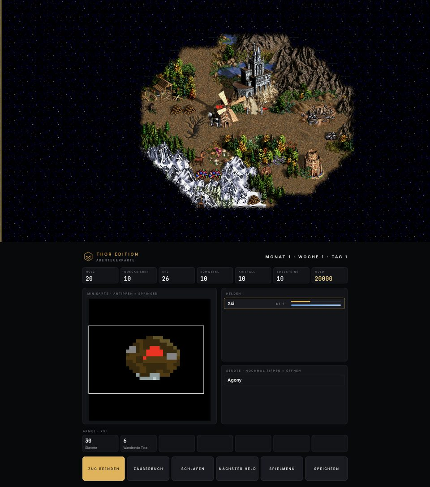
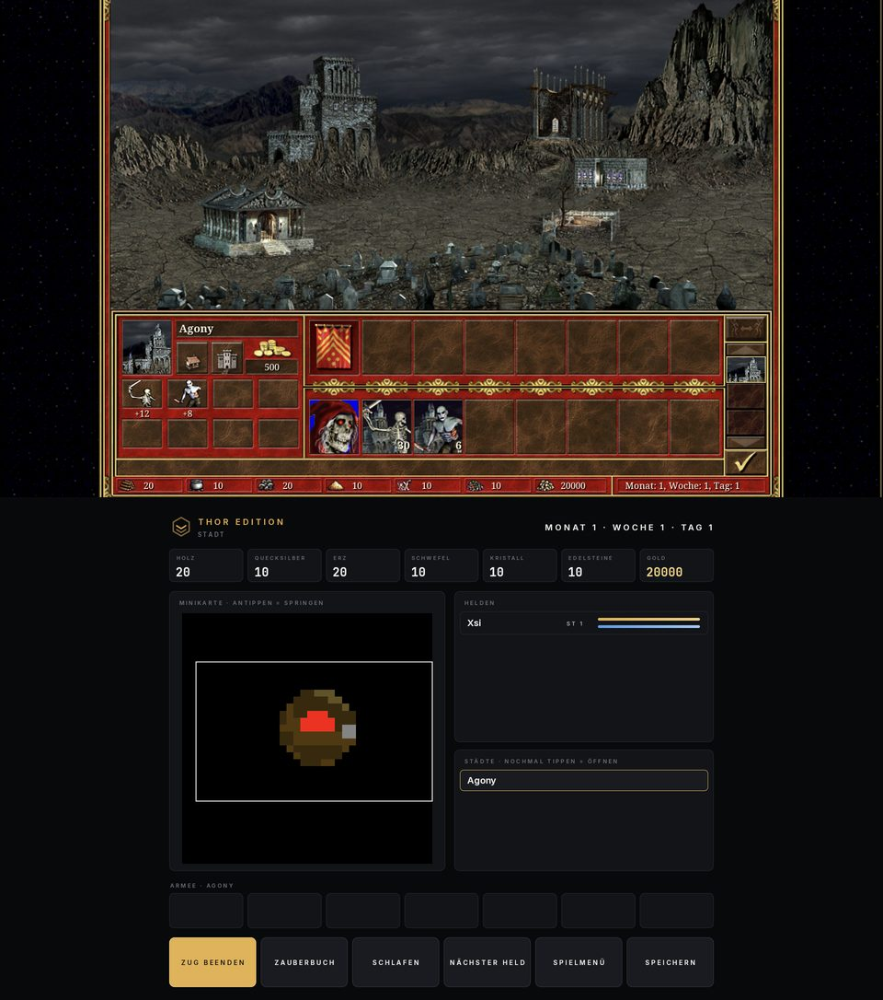
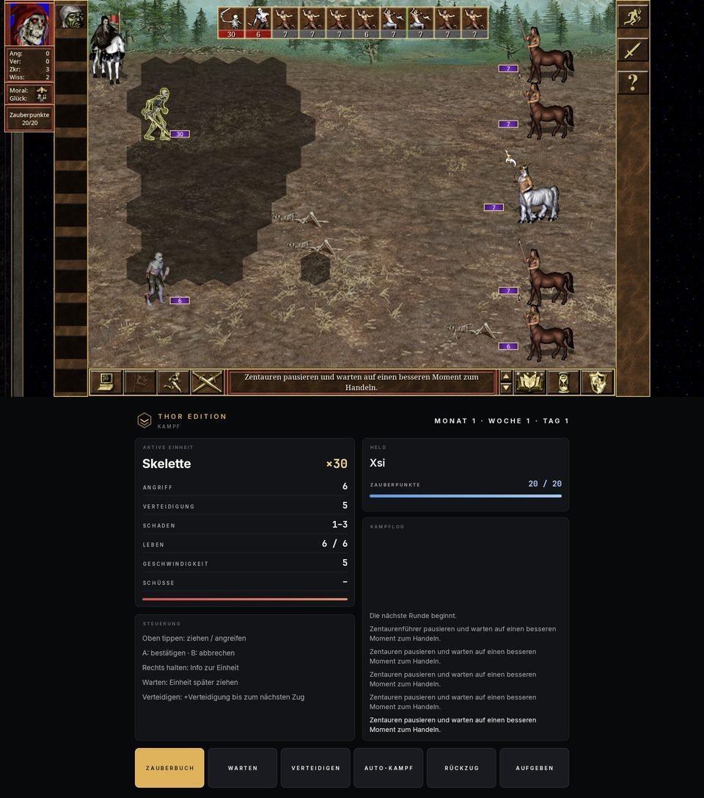
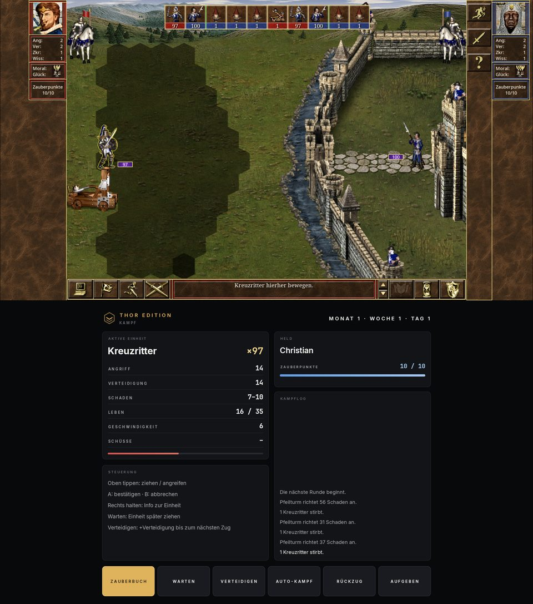
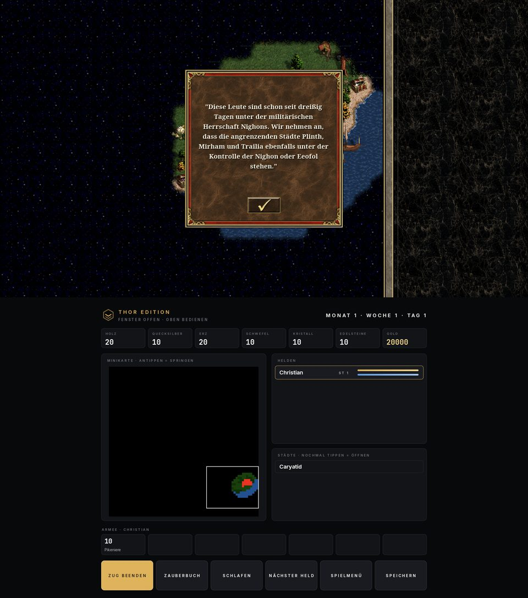

# Thor Edition for VCMI

**Unofficial** dual-screen build of [VCMI](https://github.com/vcmi/vcmi) (an open-source engine for
Heroes of Might and Magic III) for the AYN Thor handheld. Deutsch: [unten](#deutsch).

- **Top screen:** the adventure map fills the whole screen (no side panel), battles and towns as usual.
- **Bottom screen (deck):** tap the minimap to move the camera, hero and town lists (tap = select,
  tap again = open), army of the selection, resources, month/week/day, movement and spell points,
  buttons for End turn, Spellbook, Sleep/Wake, Next hero, Game menu, Save.
  In battle: active unit, hero spell points, battle log, Spellbook, Wait, Defend, Auto, Retreat, Surrender.
- **Controller** works as in VCMI; the deck never takes the controller focus.
- **Steam HD Edition support (RoE bridge):** the Steam "HD Edition" only contains *Restoration of
  Erathia* content, which stock VCMI cannot start. On first start the app converts the owner's text
  tables into the layout VCMI expects, installs the small `roe-support` mod (hides Armageddon's Blade /
  Shadow of Death content, random maps and the SoD campaign menu) and repacks the seven RoE campaigns
  as VCMI campaigns. Complete editions (GOG etc.) are used as-is.

| Adventure map + deck | Town | Battle |
|---|---|---|
|  |  |  |

| Siege | RoE campaign |
|---|---|
|  |  |

Top: game (display 0). Bottom: the Thor deck (display 4). Screenshots taken on an AYN Thor with the
author's own Steam copy (German).

Videos: showcase VIDEO_SHOWCASE · install guide VIDEO_INSTALL

## Install (English)

1. **Own the game.** This app needs *Heroes of Might and Magic III – HD Edition* (Steam) or a complete
   edition (GOG "Complete", original SoD CD). It contains no game data.
2. **Get the game folder onto the Thor** – the whole folder `Heroes of Might & Magic III - HD Edition`:
   - **from a PC:** in Steam, right-click the game → Manage → Browse local files, go one folder up and copy
     the folder over USB to the Thor, e.g. into `Download`; or
   - **with DroidDeck on the Thor:** install the game in DroidDeck's Steam, then copy the same folder from
     `Android/data/com.droiddeck.launcher/files/steam/steamapps/common/` to `Download` with a PC over USB
     (Android does not let other apps read DroidDeck's folder).
   - Only `HOMM3 2.0.exe` and the `data` folder are needed; the large `*.pak` files are skipped.
3. **Install the APK** from the [latest release](../../releases/latest) (allow installing from your browser).
4. **First start:** choose your language → *Heroes III data* → **Copy existing data** → pick the folder
   `Heroes of Might & Magic III - HD Edition` → *Use this folder* → *Allow*. The app copies about 330 MB,
   converts the tables for VCMI (RoE bridge, about a second) and shows *Finish*.
5. **Play.** Tap *Play*; the game opens on the top screen, the deck on the bottom screen.
   German HD Edition = German game; the deck follows the Android system language.

Saves live in `Android/data/de.harmssi.thorheroes/files/vcmi-data/Saves`.

### You need your own game files

This app contains **no game data**. Copy the game folder of a Heroes III version you own to the
device and import it on first start (see *Install* above).
Game graphics are only read at runtime from your files; the deck draws its own shapes and text.

### Build

`thor/build.sh [--install]` (settings in `~/.config/thorheroes/env`: `THOR_BUILD_HOST=user@linux-docker-host`, optional `THOR_BUILD_DIR`, `ANDROID_SERIAL`) builds `dist/ThorHeroes.apk`
in the image from `docker/BuildAndroid-aarch64.dockerfile` (preset `android-thor-release`).
Package `de.harmssi.thorheroes`, data in `Android/data/de.harmssi.thorheroes/files/vcmi-data`.
`thor/roe-bridge/` holds the desktop version of the converter (Python) and `thor/make_roe_mod.sh`
regenerates `android/res/raw/roe_support.zip` (JSON derived from VCMI's own config only).

### Known limitations (0.1)

- Tested with the **German** Steam HD Edition. Other languages use the same layout (`data/LOC/<lang>`)
  and should work, but are untested – please open an issue with the error if not.
- RoE 1.0 campaigns run as plain scenario chains: no start-bonus choice and no hero carry-over
  (RoE maps have no hero placeholders).
- The in-game console (Tab, cheats) lives in the hidden status bar of the full-screen map.
- Arrow towers use the ballista portrait (RoE has no tower portrait). The launcher is VCMI's own (EN/DE).
- German HD Edition: some buttons inside the game keep their English artwork (the localized sprite archive is not loaded yet).
- Based on VCMI 1.7.5 (upstream commit 6901839). Random maps, Armageddon's Blade and Shadow of Death content need a complete edition.

### Credits and licenses

- VCMI by the VCMI team and contributors - GPL-2.0-or-later (`license.txt`, `AUTHORS.h`).
  This fork is under the same license; source changes: `client/thor/`, `android/.../thor/`,
  `config/widgets/adventureMapThor.json`, `thor/`.
- `roe-support` (CC-BY-SA 4.0, see `licenses-thor/README.md`) follows the pattern of [vcmi-mods/demo-support](https://github.com/vcmi-mods/demo-support)
  (Creative Commons Attribution-ShareAlike 4.0).
- Fonts: Inter and JetBrains Mono, SIL Open Font License 1.1 (`android/res/raw/*_ofl.txt`).

### Disclaimer

Unofficial fan project. Not affiliated with or endorsed by Ubisoft, New World Computing, 3DO, AYN or
the VCMI team. "Heroes of Might and Magic" is a trademark of its owner, used only to describe
compatibility. No game data is included or distributed.

---

## Deutsch

**Inoffizieller** Dual-Screen-Build von [VCMI](https://github.com/vcmi/vcmi) (Open-Source-Engine für
Heroes of Might and Magic III) für den AYN Thor.

- **Oben:** Abenteuerkarte im Vollbild (ohne Seitenleiste), Kampf und Stadt wie gewohnt.
- **Unten (Deck):** Minikarte antippen = Kamera springt, Helden- und Städteliste (antippen = auswählen,
  nochmal = öffnen), Armee der Auswahl, Rohstoffe, Monat/Woche/Tag, Bewegungs- und Zauberpunkte,
  Knöpfe Zug beenden, Zauberbuch, Schlafen/Wecken, Nächster Held, Spielmenü, Speichern.
  Im Kampf: aktive Einheit, Zauberpunkte, Kampflog, Zauberbuch, Warten, Verteidigen, Auto, Rückzug, Aufgeben.
- **Controller** wie in VCMI; das Deck nimmt nie den Fokus.
- **Steam HD Edition (RoE-Bridge):** Die HD Edition enthält nur *Restoration of Erathia*. Beim ersten Start
  formt die App die eigenen Text-Tabellen ins von VCMI erwartete Format um, installiert die kleine Mod
  `roe-support` (blendet AB/SoD-Inhalte, Zufallskarte und SoD-Kampagnenmenü aus) und baut die sieben
  RoE-Kampagnen als VCMI-Kampagnen um. Vollversionen (GOG usw.) werden unverändert genutzt.

**Installation (Deutsch):** 1. Spiel besitzen (Steam *HD Edition* oder Complete/SoD). 2. Den ganzen Ordner
`Heroes of Might & Magic III - HD Edition` auf den Thor kopieren – vom PC (Steam → Verwalten → Lokale Dateien
durchsuchen) per USB z. B. nach `Download`, oder mit DroidDeck auf dem Thor laden und den Ordner aus
`Android/data/com.droiddeck.launcher/files/steam/steamapps/common/` per PC nach `Download` kopieren.
3. APK aus dem [neuesten Release](../../releases/latest) installieren. 4. Erster Start: Sprache → *Heroes III Daten* →
**Vorhandene Daten kopieren** → Ordner wählen → *Diesen Ordner verwenden* → *Zulassen*. Die App kopiert ~330 MB
und formt die Tabellen um. 5. *Spielen* – oben das Spiel, unten das Deck.

**Eigene Spieldateien nötig:** Die App enthält **keine Spieldaten**. Dateien einer eigenen Heroes-III-Version
im Launcher importieren („Dateien importieren“). Spielgrafiken werden nur zur Laufzeit aus diesen Dateien gelesen.

**Lizenz:** GPL-2.0-or-later wie VCMI (Dank an das VCMI-Team), `roe-support` nach demo-support (CC-BY-SA 4.0),
Schriften Inter und JetBrains Mono (SIL OFL 1.1).

**Hinweis:** Inoffizielles Fanprojekt, nicht verbunden mit Ubisoft, New World Computing, 3DO, AYN oder dem
VCMI-Team. Es werden keine Spieldaten mitgeliefert.
