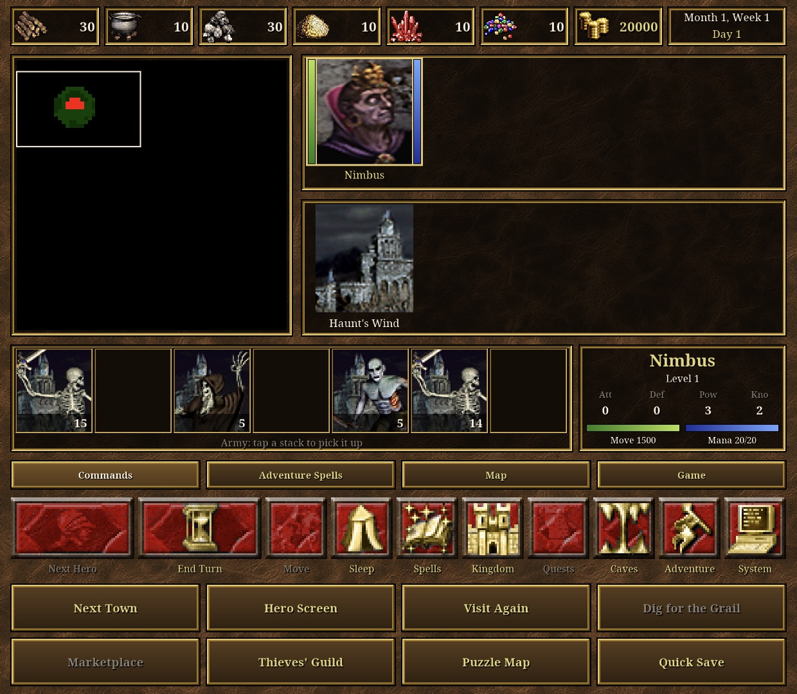

All Thor ports: [toravo.de/en/thor](https://toravo.de/en/thor/)

## Thor Edition for VCMI 0.2.0: the deck in the game's look, with a lot more on it

Unofficial fan port of Heroes of Might and Magic III (VCMI 1.7.5) for the AYN Thor. No game data included.

### New on the bottom screen
- **Game look:** the deck is drawn with the game's own interface art from your files: the stone texture, the adventure map buttons in your player colour, hero portraits, town, creature, resource and spell icons, the battle buttons, and the font the game itself uses. Nothing of it is in the app.
- **Heroes and towns with portraits:** movement and spell point bars beside every hero, sleeping heroes marked, the town icon shows whether you already built today. Tap = select, tap again = open.
- **Army:** tap a stack, then another slot to move, swap or merge it; hold the slot to split half off.
- **Commands page:** the game's own side panel buttons (next hero, end turn, move, sleep / wake, spell book, kingdom overview, quest log, surface / underground, adventure options, system options) plus next town, hero screen, visit again, dig for the Grail, marketplace, thieves' guild, puzzle map and quick save. Buttons the game does not allow right now are greyed.
- **Adventure spells page:** the spells of the selected hero with icon and cost; tap = cast (View Earth, Town Portal, Dimension Door ...; spells with a target are aimed on the top screen).
- **Map page:** view world in 1x / 2x / 4x and back, zoom in / out / reset, grid, visitable and blocked tiles.
- **Game page:** quick save, quick load, save, load, scenario info, options, main menu.
- **In a town:** town hall, fort, recruit, tavern, marketplace, mage guild, swap armies, visiting and garrison hero, previous / next town, leave.
- **Any window or question:** OK and Cancel on the deck (also arrow keys), so "end turn although heroes can still move?", retreat, surrender, build and buy questions are answered without reaching up.
- **Battle:** the turn order with creature portraits, the active unit with its values, the hero's combat spells with icon and cost (tap = cast, pick the target on the top screen), the battle log, the game's battle buttons (spell book, wait, defend, auto combat, retreat, surrender, options; next unit / start battle in the tactics phase), unit info, queue on the top screen on / off, hero statistics, battle speed slow / normal / fast.

### Tested on the Thor
A fresh game on a Restoration of Erathia map from the Steam HD Edition files (German): every page of the deck; army move and split; sleep and wake; kingdom overview, hero screen, spell book, puzzle map, thieves' guild, adventure and system options; view world 1x / 2x and back, zoom, grid, underground; quick save and quick load, save and load windows, scenario info, main menu question; a town with town hall (built a mage guild through the deck's OK), mage guild, swap armies, leave; View Earth cast from the deck; a battle with Magic Arrow cast from the deck, wait, defend, unit info, queue on / off, speed, retreat question answered with Cancel, auto combat, result closed with OK; end turn with the "heroes can still move" question. The controller works as before (A closes a message).

### Updating
Install over 0.1.0; saves and the imported game data stay.

### Known limitations
- The deck's text comes from the game font. With game files in another language than English the names of heroes, spells and creatures are in that language; the deck's own labels follow the Android system language (English or German).
- More than 16 towns or 18 combat spells: the deck shows the first ones (castable spells first); the spell book has the rest.
- Not tested: dig for the Grail, marketplace from the map, visit again, the tactics phase buttons, surrender, hero statistics, the arrow buttons, tavern / fort / recruit, more than one hero or town, 4x world view, visitable / blocked overlays.
- Still Restoration of Erathia content only with the Steam HD Edition (see README); no random maps there.

`Heroes3-Thor-Edition-v0.2.0.apk` · SHA-256 in `SHA256SUMS`
